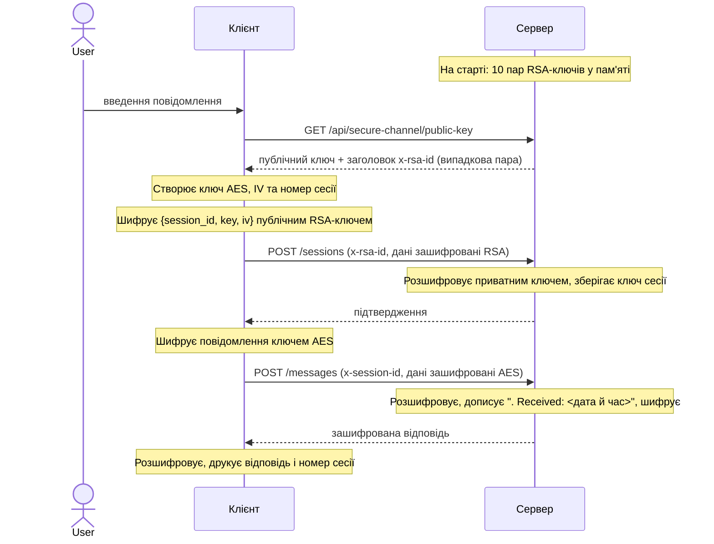

# Лабораторна робота №6. Розподілена система з шифрованим каналом

Клієнт (консольний застосунок) і сервер (Web API) обмінюються зашифрованими повідомленнями.
**RSA** захищає передачу симетричного ключа, далі повідомлення шифруються **AES**.

> Комунікація в роботі — ілюстрація асиметричного та симетричного шифрування, а не копія TLS.

## Структура

| Папка | Що це |
|---|---|
| `cryptolib/` | Спільна бібліотека: `RsaService`, `AesService`, моделі `RsaKeys`/`AesKey`, опис протоколу (назви заголовків, структура рукостискання). Її використовують і сервер, і клієнт, тому код не дублюється |
| `server/` | Web API на FastAPI (сховище в пам'яті, OpenAPI, Dockerfile) |
| `client/` | Консольний клієнт |
| `tests/` | Unit-тести (pytest): сервіси RSA/AES, протокол, API сервера, клієнт, наскрізний сценарій |
| `.github/workflows/ci.yml` | CI: збірка й тести на Python 3.11–3.13, збірка Docker-образу |

## Швидкий старт

Потрібен Python 3.10+.

```bash
python -m venv .venv
.venv\Scripts\activate            # Windows (Linux/macOS: source .venv/bin/activate)
pip install -r requirements-dev.txt
```

**Сервер** (термінал 1):

```bash
python -m securechat_server
```

Сервер слухає `http://127.0.0.1:8000`. Swagger UI: <http://127.0.0.1:8000/docs>, специфікація OpenAPI: `/openapi.json`.
На старті сервер генерує в пам'яті 10 пар RSA-ключів (перші кілька секунд).

**Клієнт** (термінал 2):

```bash
python -m securechat_client                      # або: securechat-client
python -m securechat_client --server http://localhost:8000
python -m securechat_client --reuse-session      # одна сесія на всі повідомлення
```

Порожній рядок або `exit` — вихід.

## Тести

```bash
pytest
```

Якщо pytest показує `StarletteDeprecationWarning` про `httpx` — це попередження самої бібліотеки Starlette про майбутню зміну тест-клієнта, на результат тестів воно не впливає.

## Docker

Збірку запускати з кореня репозиторію (потрібна спільна бібліотека):

```bash
docker build -f server/Dockerfile -t securechat-server .
docker run --rm -p 8000:8000 securechat-server
# або
docker compose up --build
```

## API

| Метод | Endpoint | Призначення |
|---|---|---|
| POST | `/api/crypto-keys/generate/rsa-keys` | Генерує пару RSA-ключів, зберігає в пам'яті, повертає `{"id": <int>}`. Помилка → 400 з поясненням |
| GET | `/api/crypto-keys/rsa-public-key/{id}` | Публічний ключ як base64-рядок. Немає такого `id` → 404 |
| GET | `/api/secure-channel/public-key` | Публічний ключ **випадкової** пари; номер пари в заголовку `x-rsa-id` |
| POST | `/api/secure-channel/sessions` | Рукостискання: тіло `{"encrypted_data": "<base64>"}`, заголовок `x-rsa-id`. Повертає підтвердження |
| POST | `/api/secure-channel/messages` | Тіло `{"encrypted_message": "<base64>"}`, заголовок `x-session-id`. Повертає зашифровану відповідь |
| GET | `/health` | Перевірка працездатності |

Коди помилок: `400` — неправильні дані або їх не вдалося розшифрувати; `404` — немає пари ключів / сесії;
`409` — сесія з таким номером уже існує; `503` — на сервері немає жодної пари ключів.

## Протокол



## Використані алгоритми та міркування

- **RSA-2048, OAEP (SHA-256)** — бібліотека `cryptography`. Ключі в base64: публічний — DER `SubjectPublicKeyInfo`, приватний — DER `PKCS#8`.
  За одну операцію RSA-OAEP можна зашифрувати не більше 190 байтів, тому RSA захищає лише короткі дані рукостискання (номер сесії + ключ + IV ≈ 130 байтів).
- **AES-256, режим CBC, доповнення PKCS#7** — ключ і вектор ініціалізації зберігаються в `AesKey`, як у методичці.
  IV однаковий для всіх повідомлень однієї сесії — так вимагає інтерфейс `AesService` з методички; у реальних системах IV генерують заново для кожного повідомлення, а режим CBC замінюють на AEAD (наприклад, AES-GCM).
- Номер сесії — UUID; повторно використати вже існуючий номер сесії сервер не дозволяє (`409`), щоб чужу сесію не можна було підмінити.
- Сервіси не реалізують криптографію вручну — це заборонено умовою, використовується перевірена бібліотека.
